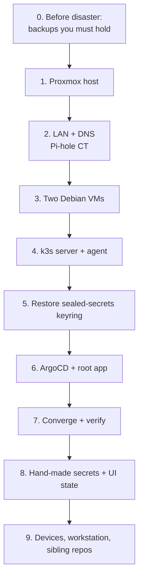

# Homelab: fresh install guide (bare metal → running platform)

This page rebuilds the whole lab from nothing: a wiped or replaced Proxmox host, new VMs, a new
cluster. It is also the procedure for a partial rebuild. Start at the phase that matches what was
lost.

DR posture (ADR 0003): **git is the source of truth; PV contents are accepted loss.** This page
covers both what git gives back and what it can't. The quarterly parity audit (does git still
match live?) lives in the DaVinci KB: `runbooks/cluster-rebuild-from-git.md`.

> **Not rehearsed end to end yet.** Phases 4–7 have never run on a blank cluster. Steps marked
> ⚠️ are reconstructed, not verified. The cheapest proof is a throwaway k3d/kind bootstrap of
> phases 5–7 (see [Rehearsal](#rehearsal)). It would have caught the 2026-10-22 Gateway
> sync-wave deadlock, which only happens on a fresh create.



| Lost | Start at |
|---|---|
| Whole host (disk died, new hardware) | Phase 0 → 1 |
| One VM or both VMs | Phase 3 |
| Cluster only (k3s datastore corrupt, nodes fine) | try the k3s datastore restore in DaVinci `runbooks/power-outage.md` first; else Phase 4 |
| An app's data | nothing to rebuild: ArgoCD recreates it empty (ADR 0003) |

---

## Phase 0: what must exist *before* a disaster

A rebuild is only as good as what you hold outside the lab. Check these quarterly.

| Item | Where | Without it |
|---|---|---|
| **sealed-secrets keyring** (every `sealed-secrets-key*` Secret) | password manager | every SealedSecret in git is undecryptable → [re-seal all of them](#if-the-keyring-is-lost) |
| Proxmox root password | you | no host access |
| SSH key `~/.ssh/id_rsa` (+ passphrase) | workstation + backup | re-key both nodes from the console |
| GitHub account (repos, PATs, OAuth apps) | GitHub | — |
| Tulip approval passphrase | your head / password manager | approvals stay disabled (fail closed) until you re-hash one |
| k3s datastore copy (optional, pre-planned outages) | on `debian` under `db-backup/` | only needed for a *cluster-only* restore |

**The keyring backup must contain the newest key.** Key renewal is **off** (`apps/sealed-secrets/values.yaml`,
2026-11-05), so the set of keys only changes if someone renews on purpose, and one export stays
complete. Before that change the controller minted a key every 30 days, and the 10-24 key was
missing from the 10-21 backup. Check, and export after any deliberate renewal:

```bash
kubectl -n sealed-secrets get secret -l sealedsecrets.bitnami.com/sealed-secrets-key \
  -o custom-columns=NAME:.metadata.name,CREATED:.metadata.creationTimestamp
kubectl -n sealed-secrets get secret -l sealedsecrets.bitnami.com/sealed-secrets-key -o yaml > keyring-$(date +%F).yaml
# → password manager. NEVER git, never a shared folder. Then delete the local file.
```

---

## Phase 1: Proxmox host ⚠️

Current host: Proxmox VE 8.4, node name `my`, Ryzen 9 5950X, 62.7 GiB RAM, one 2 TB SMR disk as
storage `hard_drive` (≈94% full, the main hardware risk).

1. **BIOS:** *Restore on AC Power Loss = Power On* (otherwise a power cut leaves the host off).
   Enable SVM/virtualisation.
2. Install Proxmox VE 8.x from ISO. Node name `my`, static IP **192.168.0.115**, gateway = the
   router, DNS = the router until Pi-hole is back.
3. Storage: add the data disk as directory storage **`hard_drive`** (VM disks are qcow2 on it).
4. Bridges: `vmbr0` on the LAN NIC (all guests use it).
5. **VirtIOFS directory mapping** `smb_storage` (Datacenter → Directory Mappings) pointing at the
   media/cache directory. The worker mounts it at `/mnt/smb_storage` (kavita, audiobookshelf,
   Petal's DinD cache). The VM side needs `expose-acl=1` (xattr) or DinD/buildkit multi-stage
   copies fail (`docs/solutions/virtiofs-xattr-dind-buildkit.md`).
6. Optional, for Claude's read-only audits: user `claude@pve` with role `ClaudeOps` and a 30-day
   token (`hosts/proxmox/k3s-vms.md`). Never a standing root SSH key.

Done when: `https://192.168.0.115:8006` loads and `hard_drive` + `smb_storage` exist.

## Phase 2: LAN and DNS (Pi-hole) ⚠️

Pi-hole is CT 107 at **192.168.0.53** and serves `*.home` plus the front-door wildcard.

1. Recreate the Pi-hole LXC (Debian template, `pihole` installer), static IP 192.168.0.53,
   `onboot=1`, `startup: order=1,up=15` so DNS comes up before the VMs.
2. Router DHCP: hand out 192.168.0.53 as DNS. Reserve the VM MACs (Phase 3 table) to .112 / .108.
3. **Front-door wildcard** (ADR 0009). On Pi-hole v6, `misc.dnsmasq_lines` =
   `address=/lab.home/192.168.0.108`; on v5, drop that line into `/etc/dnsmasq.d/`.
4. Local records (`dns.hosts`): `debian.home` → .112, `k3s-worker-01` → .108, `proxmox.home` →
   .115, `glance.home` → .118. ⚠️ The live list has 35 records and is **not captured in git**
   (capturing it needs the Pi-hole password). Export it (`pihole-FTL --config dns.hosts` or
   Teleporter) into `hosts/pihole/` the next time you're in.

Done when: `nslookup anything.lab.home 192.168.0.53` → 192.168.0.108.

## Phase 3: the two k3s VMs

Specs are in [`hosts/proxmox/k3s-vms.md`](../hosts/proxmox/k3s-vms.md). Summary:

| | VM 100 → **debian** | VM 104 → **k3s-worker-01** |
|---|---|---|
| Role | k3s server, **cordoned** | k3s agent, runs every workload |
| CPU / RAM | 6 cores `host` / 12 GiB | 8 cores `host` / 24 GiB |
| Disk | 32G qcow2 on `hard_drive`, virtio-scsi-single, iothread | 52G, same |
| NIC | **one** virtio on vmbr0, MAC `BC:24:11:0C:ED:76` | **one** virtio on vmbr0, MAC `BC:24:11:8F:CB:EE` |
| Extra | — | `virtiofs0: smb_storage,expose-acl=1` |
| Boot | `onboot=1`, guest agent on | `onboot=1`, guest agent on |

Keep the MACs so DHCP reservations still match. **Give each VM exactly one NIC.** On 2026-11-04
the worker's second NIC (vmbr3) made NetworkManager bring up the wrong interface after a power
cut, leaving the worker with no network and therefore every app down.

Install Debian 12 netinst (`debian-12.11.0-amd64-netinst.iso`) on both:

1. User `blacklotus`, SSH server, no desktop. Hostnames `debian` / `k3s-worker-01`.
2. Packages: `apt install -y qemu-guest-agent curl sudo && systemctl enable --now qemu-guest-agent`.
3. Network: DHCP (reserved) or static. If NetworkManager is installed, bind the profile:
   `nmcli con mod "Wired connection 1" connection.interface-name <nic>`.
4. SSH key auth from the workstation (`ssh-copy-id`), then disable password login.
5. Node config from [`bootstrap/nodes/`](../bootstrap/nodes/README.md):
   - both: `common/journald-size.conf` → `/etc/systemd/journald.conf.d/50-homelab-size.conf`,
     then `systemctl restart systemd-journald`
   - worker: append `worker/fstab.snippet` to `/etc/fstab`, `mkdir -p /mnt/smb_storage && mount -a`;
     install `k3s-disk-cleanup.{sh,service,timer}` and `systemctl enable --now k3s-disk-cleanup.timer`
   - debian: sudoers drop-in `/etc/sudoers.d/900-claude-ops` (via `visudo -f`): passwordless
     `/usr/local/bin/kubectl`, `/usr/bin/journalctl`, `/usr/bin/systemctl` for `blacklotus`

Done when: `ssh debian.home` and `ssh k3s-worker-01` work, and `findmnt /mnt/smb_storage` on the
worker shows virtiofs.

## Phase 4: k3s ⚠️

All flags live in `/etc/rancher/k3s/config.yaml`; the systemd units run bare `k3s server` /
`k3s agent`. **Copy the config before installing.**

```bash
# debian (server)
sudo mkdir -p /etc/rancher/k3s && sudo cp server/k3s-config.yaml /etc/rancher/k3s/config.yaml
curl -sfL https://get.k3s.io | INSTALL_K3S_VERSION=v1.34.5+k3s1 sh -s - server
sudo cat /var/lib/rancher/k3s/server/node-token      # join token: never commit

# k3s-worker-01 (agent)
sudo mkdir -p /etc/rancher/k3s && sudo cp worker/k3s-config.yaml /etc/rancher/k3s/config.yaml
curl -sfL https://get.k3s.io | INSTALL_K3S_VERSION=v1.34.5+k3s1 \
  K3S_URL=https://192.168.0.112:6443 K3S_TOKEN=<node-token> sh -s - agent

# from the workstation, once both are Ready
kubectl cordon debian     # the control plane runs no workloads
```

The server config disables traefik (ADR 0009: the Istio gateway owns 80/443 via ServiceLB).
Copy `/etc/rancher/k3s/k3s.yaml` from debian to the workstation's `~/.kube/config` and change
`server:` to `https://192.168.0.112:6443`.

Remember: with `debian` cordoned, **the worker is a single point of failure**. Nothing can
reschedule when it's down.

Done when: `kubectl get nodes` → debian `Ready,SchedulingDisabled`, k3s-worker-01 `Ready`.

## Phase 5: restore the sealed-secrets keyring (before ArgoCD exists)

ArgoCD installs the controller (`apps/sealed-secrets`, chart 2.5.19, wave -4). On first start
the controller adopts any key Secrets already in its namespace, so the keys must be there first:

```bash
kubectl create namespace sealed-secrets
kubectl apply -f keyring-<date>.yaml          # from the password manager
kubectl -n sealed-secrets get secret -l sealedsecrets.bitnami.com/sealed-secrets-key
```

If the controller started first, it minted a fresh key. Restart it to load the restored ones:
`kubectl -n sealed-secrets rollout restart deploy/sealed-secrets-controller`.

No keyring? Go on anyway, then follow [If the keyring is lost](#if-the-keyring-is-lost).

## Phase 6: ArgoCD and the root app

```bash
helm repo add argo https://argoproj.github.io/argo-helm && helm repo update
helm install argocd argo/argo-cd -n argocd --create-namespace \
  --version 10.2.1 -f apps/argocd/values.yaml     # same version as apps/argocd/application.yaml
kubectl apply -f bootstrap/root-app.yaml          # the one permitted kubectl apply
```

- The Homelab repo is public HTTPS, so ArgoCD needs **no repo credentials**.
- The ArgoCD UI is the NodePort http://192.168.0.108:31991 (k3s 1.34 port-forward is
  unreliable). Initial admin password: `argocd-initial-admin-secret`. Fetch it quietly; never
  echo it.
- ArgoCD then manages itself from `apps/argocd/`. The heartbeat app (wave -1) lands first.

## Phase 7: converge and verify

Give it 15–30 minutes (image pulls on one worker). Then:

```bash
kubectl get nodes
kubectl -n argocd get applications | grep -v 'Synced.*Healthy'   # only audiobookshelf (Suspended) should be left
kubectl get pods -A | grep -vE 'Running|Completed'
```

The load-bearing signals:
- `probe_success == 1` for every `front-doors` and `gateway-front-doors` target in vmsingle. This
  proves Pi-hole wildcard → ServiceLB → gateway → CA chain.
- A heartbeat commit lands on the `heartbeat` branch (the GitHub watchdog stops paging "Cluster dark?").
- https://warden.lab.home/map is all green.

Known first-boot noise: petal dind restarts 2–3×, istio-cni/ztunnel restart a few times, and the
root app can wedge on health (DaVinci `runbooks/argocd-app-of-apps-wedge.md`).

## Phase 8: what git doesn't recreate

### Hand-made Secrets (not in git, not sealed)

These exist live only. After a rebuild they're **missing**, and their apps fail until you
recreate them. (Inventory 2026-11-05: unowned Secrets with no ArgoCD tracking.)

| Secret | Keys | Get the value from | Breaks without it |
|---|---|---|---|
| `backstage/backstage-github-token` | `GITHUB_TOKEN` | new GitHub PAT (repo read) | Backstage catalog/integrations |
| `backstage/backstage-github-auth` | `AUTH_GITHUB_CLIENT_ID`, `AUTH_GITHUB_CLIENT_SECRET` | GitHub OAuth app → Backstage | Backstage login |
| `backstage/backstage-k8s-token` | `K8S_SA_TOKEN` | a token for the `backstage-k8s-rbac` ServiceAccount | Backstage Kubernetes tab |
| `tulip/tulip-approval` (optional) | `TULIP_APPROVAL_PASSPHRASE_HASH` | `go run . hash-passphrase` in Tulip, **on your machine** | approvals disabled (fail closed). Currently absent, by design |

Sealing these three Backstage secrets into git would remove them from this list.

### UI and per-device state

- **uptime-kuma:** run `tools/uptime-kuma/provision.py` (idempotent; monitors are in
  `tools/uptime-kuma/monitors.yaml`, admin from the sealed `uptime-kuma-admin`).
- **authentik:** admin login + the OIDC provider half of each integration.
- **Local CA:** a rebuild mints a **new** CA (the private key lives only in-cluster). Re-trust
  `lab-root-ca.crt` on each device:
  `kubectl -n cert-manager get secret lab-root-ca -o jsonpath='{.data.ca\.crt}' | base64 -d > lab-root-ca.crt`
  → Windows `certutil -addstore -user Root lab-root-ca.crt`; phone and Firefox import it themselves.
  Also copy it to Glance (`hosts/README.md`).
- **ntfy on the phone:** subscribe to `homelab-alerts`, `warden`, `tulip-approvals` at
  http://192.168.0.108:30310.
- **Tulip:** the paper book restarts from 10,000 CAD (its journal PVC is gone); shadow books
  restart their common start date.

### Data that is gone (ADR 0003, accepted)

Every PVC is `local-path` on the worker's disk: the authentik DB, Backstage DB, Grafana,
VictoriaMetrics, OpenObserve, uptime-kuma, linkding, **Petal run history, Tulip journal, Warden
journal**. The media on `/mnt/smb_storage` (kavita, audiobookshelf) lives on the host and
survives a cluster rebuild, but not a host loss.

### Floaters (decide, don't restore)

Live-only and never in git: juice-shop (:30001), portainer-agent (:9001), and the whole
**paperless** namespace (scaled to 0, 6 PVCs). Adopt them into git or let them go.

## Phase 9: devices, workstation, sibling repos

- **Workstation tools:** `kubectl`, `helm` (v4), `argocd` (v3.5), `kubeseal` (match chart
  2.5.19's controller), `gh`. Use Windows OpenSSH (System32), not Git Bash ssh, for the agent.
- **Sibling repos** need no cluster-side setup. Their images are public on `ghcr.io` and are
  pinned by SHA in `services/<name>/`. Rebuilding the cluster doesn't touch them.
- **DaVinci** (the knowledge base + MCP) is per workstation: `git clone` + `scripts/setup.ps1`.
  Warden git-syncs its `docs/` read-only on its own.
- **Exercises:** run the watchdog `workflow_dispatch` with `test_alert=true`, then a staging
  rehearsal (ADR 0006).

---

## If the keyring is lost

Every SealedSecret in git becomes noise. Each one needs its plaintext recreated and re-sealed
against the new controller key (`kubeseal --controller-namespace sealed-secrets -o yaml`), then
committed:

| SealedSecret (namespace/name) | File | Recreate from |
|---|---|---|
| `monitoring/grafana-admin-credentials` | `infrastructure/victoria-metrics/sealed-grafana-admin.yaml` | pick a new password |
| `monitoring/uptime-kuma-admin` | `infrastructure/uptime-kuma/sealed-admin.yaml` | pick a new password |
| `default/authentik-credentials` | `services/authentik/sealedsecret.yaml` | new secret key + DB password (fresh DB anyway) |
| `heartbeat/heartbeat-github-pat` | `infrastructure/heartbeat/sealed-github-pat.yaml` | new fine-grained PAT (Homelab `heartbeat` branch write) |
| `backstage/backstage-argocd-token` | `infrastructure/backstage-k8s-rbac/sealed-argocd-token.yaml` | new ArgoCD API token |
| `backstage/backstage-external-access` | `infrastructure/backstage-k8s-rbac/sealed-external-access.yaml` | new static token |
| `backstage/petal-api-token`, `petal/petal-api-token` | `infrastructure/backstage-k8s-rbac/sealed-petal-token.yaml`, `services/petal/sealed-api-token.yaml` | one new random token, sealed into both |
| `petal/petal-secrets` | `services/petal/sealed-secrets.yaml` | Petal's pipeline secrets (Petal ADR 0006) |
| `tulip/tulip-api-token` | `services/tulip/sealed-api-token.yaml` | new random token (update Claude Code's MCP config to match) |
| `tulip/tulip-questrade` | `services/tulip/sealed-questrade.yaml` | new Questrade refresh token (single use, ADR 0003) |
| `arc-runners/arc-runner-secret` | `infrastructure/arc-runners/sealed-github-pat.yaml` | only if ARC is reactivated (ADR 0010) |

## Rehearsal

To prove phases 5–7 without touching the real cluster, run them on a throwaway k3d cluster.
Point a copy of `root-app.yaml` at a branch and expect the hand-made secrets and the
host-specific bits (virtiofs, NodePorts, Pi-hole) to fail. Everything else should converge.
Record the result here and drop the ⚠️ marks it clears.

### 2026-11-05: k3d on `ubuntu.home`, no keyring

k3d v5.8.3, k3s v1.34.5 (1 server cordoned + 1 agent, traefik disabled, same eviction-hard),
ArgoCD 10.2.1 from `apps/argocd/values.yaml`, root app on a throwaway branch with `tulip`,
`heartbeat` and `petal` removed (outward side effects: orders, heartbeat commits, image
pushes). No keyring restored, so phase 5 ran as [If the keyring is lost](#if-the-keyring-is-lost).

- **Converged in ~20 min:** 22/30 apps. No sync-wave deadlock; gateway Programmed; cert-manager
  minted a fresh `lab-root-ca` and wildcard cert. ~5.5 GiB RAM across both nodes.
- **Expected failures:** 6 SealedSecrets (no key), `backstage-github-token` (hand-made,
  Phase 8), and the petal/tulip HTTPRoutes (removed apps).
- **Real rebuild blockers found and fixed:**
  1. authentik's pinned digest 404'd on ghcr; production only ran it from the worker's image
     cache. Re-pinned to the digest tag `2025.2.4` serves (built 2025-04-08).
  2. `services/linkding/pvc.yaml` pinned `volumeName` to this cluster's PV, so a fresh claim
     stayed Pending forever. Removed; the app ignores and respects `/spec/volumeName`.
- **Not proven:** Phase 4's host install (k3d skips the install script and systemd units, so
  its ⚠️ stays), Phase 5's keyring restore, and the virtiofs/NodePort/Pi-hole pieces.
- **Lesson:** a digest pin can rot while production keeps running from cache. Before trusting
  a rebuild, check every pinned image still resolves, for example
  `curl -sI -H "Authorization: Bearer <anon token>" https://ghcr.io/v2/<repo>/manifests/<digest>`.

## Out-of-git ledger (summary)

| Layer | Lives in | Captured in git? |
|---|---|---|
| Proxmox host config, other LXCs (immich, vault, npm, smb, portainer…) | the host | no. Only the k3s VM specs (`hosts/proxmox/`) |
| Pi-hole `dns.hosts` (35 records) | Pi-hole | **no**. Wildcard line: yes, documented above |
| Node OS, SSH keys, sudoers, k3s join token | nodes | config yes (`bootstrap/nodes/`); secrets no |
| sealed-secrets keyring | password manager | never |
| Hand-made Secrets (Phase 8) | cluster | **no** |
| ArgoCD initial admin, chart-repo registrations | cluster | recreated by Phase 6 |
| UI state (authentik providers, phone subscriptions, Renovate dashboard) | each app / device | no |
| Glance dashboard | LXC 116 | yes (`hosts/glance/`) |
| PV data | worker disk | no, accepted loss (ADR 0003) |
